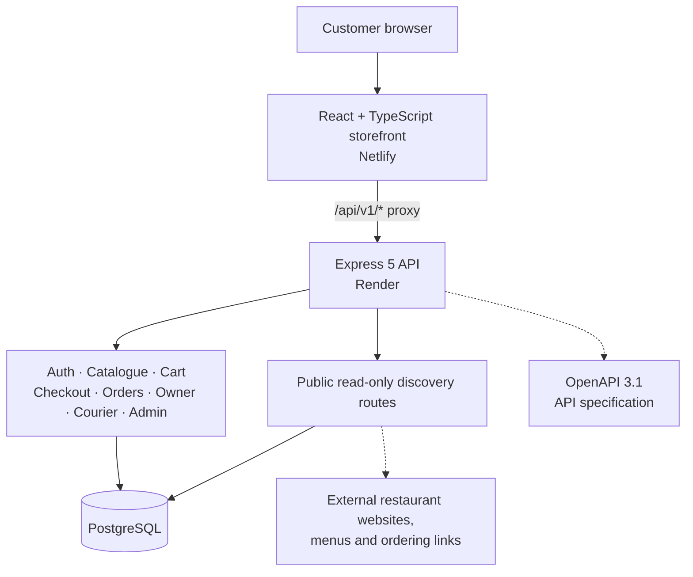

<h1 align="center">CraveDirect</h1>

<p align="center">
  <strong>Your cravings. Handled.</strong><br />
  A food discovery storefront connecting people with local favourites and new places to explore.
</p>

<p align="center">
  <a href="https://cravedirect-web.netlify.app/"><strong>↗ Visit the live CraveDirect website</strong></a>
</p>

<table width="100%">
  <tr>
    <td width="50%" valign="top">
      <a href="https://cravedirect-web.netlify.app/">
        
      </a>
      <p align="center"><strong>Storefront</strong></p>
    </td>
    <td width="50%" valign="top">
      <a href="https://cravedirect-web.netlify.app/">
        
      </a>
      <p align="center"><strong>Discover food</strong></p>
    </td>
  </tr>
  <tr>
    <td width="50%" valign="top">
      <a href="https://cravedirect-web.netlify.app/">
        
      </a>
      <p align="center"><strong>Restaurant listings</strong></p>
    </td>
    <td width="50%" valign="top">
      <a href="https://cravedirect-web.netlify.app/">
        
      </a>
      <p align="center"><strong>Discovery experience</strong></p>
    </td>
  </tr>
</table>

<p align="center">
  <a href="https://github.com/Rishidev-20thcenturey/food-delivery-api/actions/workflows/backend.yml"></a>
  
  
  
  
  
</p>

<p align="center">
  <a href="#-quick-start">Quick start</a> &nbsp;·&nbsp;
  <a href="https://cravedirect-web.netlify.app/">Live storefront</a> &nbsp;·&nbsp;
  <a href="https://cravedirect-api.onrender.com/api/v1/health">Live API health</a> &nbsp;·&nbsp;
  <a href="frontend/">Frontend source</a> &nbsp;·&nbsp;
  <a href="backend/docs/openapi.yaml">API specification</a> &nbsp;·&nbsp;
  <a href="backend/docs/FRONTEND_INTEGRATION.md">Frontend guide</a> &nbsp;·&nbsp;
  <a href="backend/docs/DISCOVERY.md">Global discovery guide</a>
</p>

<p align="center">
  <strong>A typed REST API for the full food-delivery order lifecycle.</strong><br/>
  Browse restaurants, manage carts, calculate prices safely, place orders, and coordinate owner, courier, and admin workflows.
</p>

> [!IMPORTANT]
> **Live deployment and source:** The React/Vite storefront, API, and global-discovery implementation are part of the integrated CraveDirect codebase. The live [storefront](https://cravedirect-web.netlify.app/) is hosted on Netlify and uses the [Render API](https://cravedirect-api.onrender.com/api/v1/health). GitHub source updates do not change Netlify or Render settings automatically; deployment behavior still depends on the host configuration. CraveDirect is an MVP/demo, not a production-ready, globally orderable marketplace.

---

## ✨ Project at a glance

<table>
  <tr>
    <td align="center" width="33%">
      <h2>54</h2>
      <strong>Documented API operations</strong><br/>
      <sub>Includes the 3 public discovery operations</sub>
    </td>
    <td align="center" width="33%">
      <h2>184</h2>
      <strong>Backend tests recorded as passing</strong><br/>
      <sub>12 test files; CI verifies the merge candidate</sub>
    </td>
    <td align="center" width="33%">
      <h2>4</h2>
      <strong>Access roles</strong><br/>
      <sub>Customer · Owner · Courier · Admin</sub>
    </td>
  </tr>
</table>

## 🧭 Contents

- [Features](#-features)
- [Architecture](#-architecture)
- [Technology stack](#-technology-stack)
- [Quick start](#-quick-start)
- [Useful commands](#-useful-commands)
- [API overview](#-api-overview)
- [Global food discovery](#-global-food-discovery)
- [Frontend integration](#-frontend-integration)
- [Verification](#-verification)
- [Limitations and roadmap](#-limitations-and-roadmap)
- [Project structure](#-project-structure)

## 🚀 Features

<table>
  <tr>
    <td width="50%" valign="top">
      <h3>🔐 Authentication &amp; access</h3>
      Customer registration and login, rotating refresh-token cookies, role-based permissions, input validation, and ownership checks.
    </td>
    <td width="50%" valign="top">
      <h3>🍽️ Restaurant catalogue</h3>
      Browse restaurants, menus, categories, availability, and customer reviews.
    </td>
  </tr>
  <tr>
    <td width="50%" valign="top">
      <h3>🛒 Cart &amp; checkout</h3>
      Delivery addresses, a single-restaurant cart, server-side pricing, checkout preview, and idempotency protection.
    </td>
    <td width="50%" valign="top">
      <h3>📦 Order lifecycle</h3>
      Owner accept/reject and preparation, courier assignment, delivery status timeline, cancellation rules, and order history.
    </td>
  </tr>
  <tr>
    <td width="50%" valign="top">
      <h3>🛠️ Admin operations</h3>
      Manage users and restaurants, assign couriers, cancel eligible orders, and inspect audit logs.
    </td>
    <td width="50%" valign="top">
      <h3>📘 Developer experience</h3>
      OpenAPI 3.1, consistent errors, pagination, request IDs, SQL migrations, demo seeds, and automated tests.
    </td>
  </tr>
  <tr>
    <td width="50%" valign="top">
      <h3>🖥️ Live customer storefront</h3>
      The deployed React and TypeScript interface supports restaurant search, cuisine filters, menu browsing, customer accounts, cart management, delivery addresses, cash-on-delivery checkout, and order history.
    </td>
    <td width="50%" valign="top">
      <h3>🌍 Global food discovery</h3>
      A separate public, read-only directory with place, country, city, and cuisine filters. External listings are discoverable but are not automatically orderable through CraveDirect.
    </td>
  </tr>
</table>

## 🏗️ Architecture



The server is the source of truth for prices and order rules. Monetary amounts use integer **paise** (`19900` means ₹199.00), not floating-point currency values.

## 🧰 Technology stack

| Layer | Technology |
| --- | --- |
| Frontend | React 19, TypeScript, Vite |
| Frontend hosting | Netlify |
| Backend runtime | Node.js 20.19+ |
| API hosting | Render |
| Language | TypeScript |
| HTTP server | Express 5 |
| Database | PostgreSQL |
| Validation | Zod |
| Automated tests | Vitest + Supertest |
| API documentation | OpenAPI 3.1 |

## 🚀 Quick start

> This repository includes the integrated frontend and backend. The commands below start the API; see [frontend/README.md](frontend/README.md) for running the React/Vite storefront locally. Node.js 22 is recommended for the full repository (the backend itself supports Node.js 20.19+).

### Prerequisites

- Node.js **20.19 or newer**
- npm
- PostgreSQL, or the included local embedded-PostgreSQL helper

### 1. Configure environment variables

From the repository root:

```bash
cd backend
cp .env.example .env
```

Edit `.env` and set:

- `DATABASE_URL` — PostgreSQL connection string.
- `JWT_ACCESS_SECRET` — a private random secret of at least 32 characters.
- `DEV_SEED_PASSWORD` — development-only password of at least 8 characters for demo accounts.

**Never commit real secrets or your `.env` file.** The example configuration is for local development only.

### 2. Install dependencies

```bash
npm ci
```

### 3. Start the local database

Open a terminal in `backend/` and run this command, leaving it running:

```bash
npm run db:embedded
```

This starts the development database on port `54330`. Alternatively, configure `DATABASE_URL` to use a PostgreSQL instance you manage.

### 4. Run migrations and seed demo data

In another terminal, still in `backend/`:

```bash
npm run db:migrate
npm run db:seed
```

The development seed creates sample customer, restaurant-owner, courier, and admin accounts, plus demo restaurants and menu items. Their shared demo password is the value you set in `DEV_SEED_PASSWORD`. The seed is idempotent and refuses to run in production.

### 5. Start the API

```bash
npm run dev
```

| Resource | Local URL |
| --- | --- |
| API base | [http://localhost:4000/api/v1](http://localhost:4000/api/v1) |
| Health | [http://localhost:4000/api/v1/health](http://localhost:4000/api/v1/health) |
| Readiness | [http://localhost:4000/api/v1/ready](http://localhost:4000/api/v1/ready) |
| Documentation index | [http://localhost:4000/docs](http://localhost:4000/docs) |
| OpenAPI specification | [http://localhost:4000/api/v1/openapi.yaml](http://localhost:4000/api/v1/openapi.yaml) |

## ⌨️ Useful commands

Run these in `backend/`:

| Command | What it does |
| --- | --- |
| `npm run dev` | Start API with reload |
| `npm run build` | Compile TypeScript to `dist/` |
| `npm start` | Run compiled API |
| `npm run typecheck` | Check TypeScript types |
| `npm run lint` | Run ESLint |
| `npm test` | Run tests using a separate test database |
| `npm run db:migrate` | Apply SQL migrations |
| `npm run db:seed` | Populate development demo data |
| `npm run db:embedded` | Start local development PostgreSQL |

## 🔌 API overview

Every route is under `/api/v1` unless noted otherwise.

| Area | Representative routes |
| --- | --- |
| Authentication | `POST /auth/register`, `POST /auth/login`, `POST /auth/refresh`, `POST /auth/logout` |
| Restaurants &amp; menus | `GET /restaurants`, `GET /restaurants/{id}/menu`, `GET /restaurants/{id}/reviews` |
| Addresses &amp; cart | `/me/addresses`, `/cart`, `/cart/items` |
| Checkout &amp; orders | `POST /checkout/preview`, `POST /checkout`, `GET /orders`, `GET /orders/{id}` |
| Restaurant owner | `/owner/restaurants`, `/owner/orders` |
| Courier | `/courier/deliveries` |
| Administrator | `/admin/users`, `/admin/restaurants`, `/admin/orders`, `/admin/audit-logs` |
| Public discovery | `GET /discovery/places`, `GET /discovery/places/{id}`, `GET /discovery/facets` |

See the [API specification](backend/docs/openapi.yaml) for the complete request and response schemas.

## 🌍 Global food discovery

The public, read-only restaurant directory sits alongside the existing CraveDirect orderable catalogue. Visitors can search and filter external places by text, country, city, cuisine, and related facets. Listings may include source attribution and links to a restaurant's own website, menu, or official ordering page.

**Discovery is not worldwide ordering.** Imported places do not automatically become CraveDirect merchants. A listing can use CraveDirect's cart and checkout only after an operator explicitly links it to an active CraveDirect restaurant. The existing ordering flow remains India-focused and cash-on-delivery only. Directory coverage depends on permitted data being imported; the implementation does not imply that every restaurant worldwide is listed.

See the [global discovery guide](backend/docs/DISCOVERY.md) for data sources, licensing, imports, safeguards, and limitations.

## 🤝 Frontend integration

The storefront source is in [frontend/](frontend/). Netlify routes `/api/v1/*` requests through an Edge Function to the API, while local Vite development proxies requests to the local API server.

Use these documents as the source of truth when connecting a web or mobile frontend:

| Guide | What it covers |
| --- | --- |
| [Frontend integration guide](backend/docs/FRONTEND_INTEGRATION.md) | Customer, owner, courier, and admin flows, browser setup, and sample data |
| [API contract](backend/docs/API_CONTRACT.md) | Authentication, errors, pricing, pagination, and order lifecycle |
| [OpenAPI 3.1](backend/docs/openapi.yaml) | Endpoint and schema reference |
| [Integration status](backend/docs/INTEGRATION_STATUS.md) | Current backend, discovery, frontend, verification, and known limitations |

**Browser note:** Requests that use the refresh-token cookie must include credentials (for Fetch, `credentials: "include"`), and the frontend origin must be permitted by `CORS_ORIGINS`. Keep the access token in memory rather than local storage.

## ✅ Verification

The last recorded successful backend run on the integrated code passed **184 tests across 12 test files**, and the frontend production build also passed. The current pull request runs both backend and frontend CI against the combined tree before it is merged. Results can be checked in [GitHub Actions](https://github.com/Rishidev-20thcenturey/food-delivery-api/actions).

## 🛣️ Limitations and roadmap

The storefront and API demo are deployed, but CraveDirect is still an MVP and is not production-hardened or globally orderable end-to-end.

- **Payments:** cash on delivery only; online payments are not implemented.
- **Live tracking:** order status must be refreshed or polled; there are no push updates or WebSockets.
- **Promotions:** coupons and discounts are not implemented.
- **Account verification:** email and phone verification are not implemented.
- **Images:** image fields accept URLs; file uploads are not included.
- **Global discovery:** available coverage depends on permitted source data being imported; the directory does not guarantee complete worldwide coverage, verified opening hours, or structured menus for every listing.
- **Production hardening:** managed PostgreSQL operations, backups, monitoring, load testing, and an independent security review are still needed.

## 📁 Project structure

```text
.
├── .github/
│   ├── scripts/                    # Manual OSM import utilities
│   └── workflows/                 # Backend, frontend, discovery import
├── frontend/                      # React + TypeScript + Vite storefront
├── netlify/
│   └── edge-functions/             # Same-origin API proxy
├── backend/
│   ├── src/
│   │   ├── modules/       # Auth, restaurants, discovery, cart, checkout, orders, owner, courier, admin
│   │   ├── db/            # PostgreSQL connection, migrations, seeds and discovery importer
│   │   ├── middleware/    # Auth, validation, rate limiting, request IDs
│   │   └── server.ts
│   ├── tests/             # API and database tests
│   ├── docs/
│   │   ├── openapi.yaml
│   │   ├── API_CONTRACT.md
│   │   ├── DISCOVERY.md
│   │   ├── FRONTEND_INTEGRATION.md
│   │   └── INTEGRATION_STATUS.md
│   ├── .env.example
│   └── package.json
├── netlify.toml
├── render.yaml
└── scripts/                       # Build and deployment notes

---

<p align="center">
  <sub>Built with React, TypeScript, Express, and PostgreSQL · API v1</sub><br/>
  <a href="backend/docs/INTEGRATION_STATUS.md">Integration status</a> ·
  <a href="frontend/">Frontend source</a> ·
  <a href="backend/docs/DISCOVERY.md">Global discovery guide</a> ·
  <a href="backend/docs/openapi.yaml">API specification</a>
</p>
